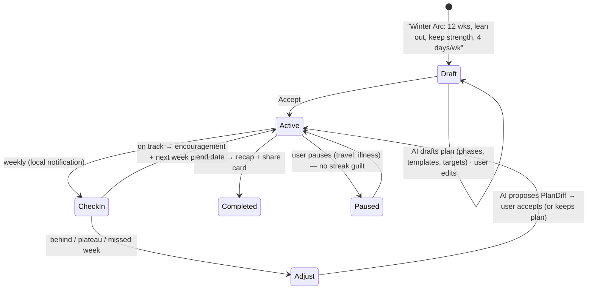
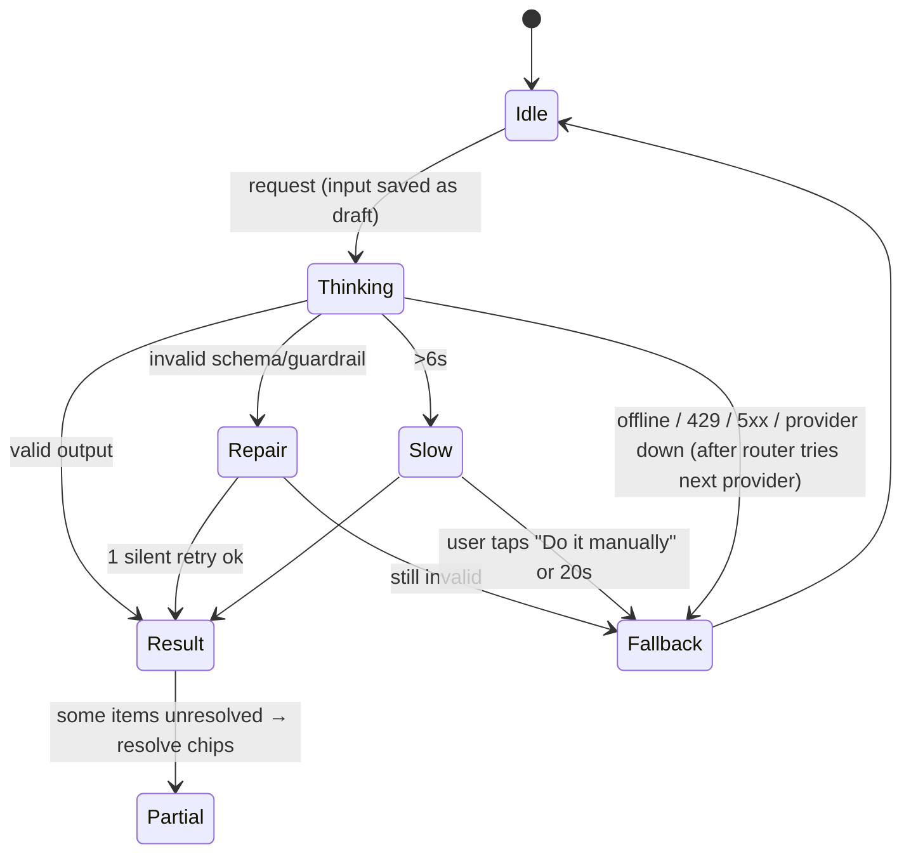

# AI architecture: AI-native experience, providers, infra

**Status:** accepted, 2026-11-03.

**Supersedes:** the "numbers from rules, words from AI" rule in [PRODUCT-STRATEGY.md](PRODUCT-STRATEGY.md) §2 and its Guardrails. The replacement is **"AI proposes, rules verify, the user applies."**

**Resources:** [docs/ai/RESOURCES.md](../ai/RESOURCES.md). **Evals:** [evals/README.md](../../evals/README.md).

## Context
Until now, AI in Incline only rewrote text the rules had already produced (`coach-narrate` + `FeaturePackV1`). We are moving to an app where AI genuinely helps people act:
- build and change templates;
- run challenges like Winter Arc;
- use health and nutrition data.

It must be friendly and must not make things up. It must also fail cleanly when the network or the AI fails.

This doc covers four things:
1. The experience and the use cases.
2. The smallest mechanism that makes each use case reliable.
3. Providers and infrastructure (OpenRouter, Groq, Expo AI, Cloudflare).
4. The order of work.

## Architecture (the stable seams)

```mermaid
flowchart TB
  subgraph UI["Surfaces"]
    V[Voice] --- AB[Ask sheet] --- CC[Suggestion chips / coach cards] --- TE[Template & challenge editors]
  end
  subgraph Core["src/ai (app)"]
    INT[Task registry<br/>id · schema · tier · validator · fallback]
    RT[Router<br/>user mode · capability · availability · fallback chain]
    AG[Agent loop<br/>step cap · tool approval]
    TL[Tool registry<br/>read-only, batched queries]
    GR[Guardrails<br/>bounds · ids resolve · units · preferences]
    PR[Proposals<br/>versions · undo · activity log]
    MEM[coach_memory + ai_feedback]
  end
  subgraph Prov["Provider adapters (one interface)"]
    ON[on-device: expo-ai]
    GW[Incline gateway]
    BY[BYOK]
    NO[none: rules copy]
  end
  subgraph Cloud["Supabase edge 'ai-task'"]
    AUTH[Clerk JWT] --> QUOTA[per-user quota + cache] --> CFG[Cloudflare AI Gateway] --> UP[(Groq · OpenRouter)]
  end
  SQL[(SQLite — source of truth)]
  SRC[Data sources: CSV · Health Connect · Hevy]
  UI --> INT --> RT --> Prov
  RT --> AG --> TL --> SQL
  AG --> GR --> PR -->|user applies| SQL
  GW --> Cloud
  SRC -->|mutate()| SQL
  MEM <--> SQL
  TL -.same definitions.-> MCP[incline-mcp #35;242]
```

| Fixed contracts | Swappable behind them |
|---|---|
| Provider: `generate({messages, schema?, tools?, signal})` + declared `capabilities` | any model, vendor or runtime (all hosted ones over the OpenAI-compatible API) |
| Task definitions: zod schemas, versioned prompts, validator, fallback | prompts, and which model serves each task |
| Read-only tool registry; typed actions and diffs; `Proposal` | agent loop internals; MCP exposure |
| DataSource → normalised rows carrying `source` + `external_id` | Health Connect, Hevy, CSV, Garmin… |
| `mutate()` is the only write path | — |

- **No agent framework.** No LangChain, LangGraph or Mastra. Our own loop is about 80 lines with a step cap, which is enough for under 10 tools.
- **Shared contract code.** Schemas, prompts and validators live in one module imported by both the app and Deno, which also closes #189.

The plan the user approved follows.

---

## 1. Experience principles (the "feel" contract)
1. **Act, don't lecture.** Every AI response ends in at most 3 typed actions, such as Apply, Start, Swap or Log. Paragraphs are optional; buttons are not.
2. **Suggest → Preview → Apply → Undo.** Nothing the AI does changes data without a preview, or for instant-tier actions an Undo toast.
3. **Grounded or silent.**
   - Facts come only from tool results: history, catalog, health data, food databases.
   - Numbers are checked against tool output. This generalises the existing `collectAllowedNumbers`.
   - Estimates are labelled as estimates, e.g. "≈ 32 g protein (estimate)".
   - When the data isn't there: "I don't have enough data yet."
4. **Show your basis.** A small source chip, such as "Based on your last 6 bench sessions", which you tap to see the data.
5. **Context-aware, not chatty.** Suggestions appear where the decision is made (template editor, session, Home). The Ask sheet opens already scoped to what you're looking at.
6. **The gym loop never waits.** Logging, timers and session flow never block on the network or the AI.
7. **Tone:** friendly, short and plain. No hype, no guilt, no medical claims. For injuries: offer safe alternatives and suggest seeing a professional.

---

## 1b. Cross-cutting pillars (these apply to every use case below)

### Personalisation: learns, visibly
- **Signals.** Every proposal outcome is recorded locally in `ai_feedback`, as `{proposalId, task, outcome: applied|edited|rejected|regenerated, editDiff, reasonChip}`. Also recorded:
  - what users actually log, versus what was planned (swaps, skipped exercises, real session length);
  - which suggestion chips they tap and which they ignore.
- **Learning is rules and counts with decay, not fine-tuning.** Signals are turned into preference facts in `coach_memory`, for example:
  - "prefers dumbbells";
  - "avoids barbell squat";
  - "sessions ≈ 50 min";
  - "likes 6–10 reps";
  - "trains Tue/Thu/Sat".

  Every fact has `confidence`, a `source` (said or learned), `lastSeen`, and expires if it isn't reinforced.
- **Cold start** uses onboarding answers plus imported history, so the app is useful on day one.
- **Context injection.** The top relevant preferences go into each task's context, and guardrails respect them. Hard constraints like injuries and equipment are filters; soft preferences only nudge rankings.
- **"What Incline knows about you" screen.** You can see, edit, remove or reset each fact, plus a global "pause learning" toggle.

### Feedback loops: correct, refine, regenerate
- Every `ProposalCard` has:
  - **Apply**;
  - **Edit** (opens the normal editor, prefilled);
  - **Refine…** (free text such as "fewer sets", "no machines", plus quick chips);
  - **Regenerate**;
  - per-item **Swap** / **Remove**.
- **Proposal versions.** Regenerate and Refine create v2, v3…; you can step back and forth, and nothing is lost.
- **Edits teach.** When a user edits a proposal before applying, the diff between proposal and applied version is the strongest preference signal.
- **Quick 👍/👎 with reason chips,** e.g. "too long", "wrong equipment", "too easy". The chips feed preferences; free text is optional.
- **Corrections after the fact** ("actually 95", "that wasn't a PR") go through the same typed actions and are logged.

### Transparency and control: suggested vs changed vs tracked
- **Three visual states,** used the same way everywhere:

| State | Visual | Meaning |
|---|---|---|
| **Suggested** | dashed outline + spark badge | Not applied; nothing has changed |
| **Applied with AI** | small "AI-assisted" tag on the item, plus an entry in the activity log | You applied it; Undo is available, and a revert from the log afterwards |
| **Tracked / imported** | source badge: Health Connect, Samsung Health, CSV, Hevy | Came from another app; read-only provenance |

- **AI activity log** (Profile → AI activity). Every AI-originated change appears here with its time, the before → after diff, and Revert where possible. Instant-tier actions (voice logs) are listed too.
- **No silent changes.** Background jobs such as challenge check-ins and readiness only ever create *suggestions*.
- **Controls:**
  - AI mode: Off / on-device only / cloud / own key;
  - per-feature toggles;
  - learning pause;
  - clearing memory and the activity log.

### Consistency: one system, many surfaces
- **One action vocabulary.** Typed actions and diffs (`TemplateDiff`, `PlanDiff`, `LogSet`, `NutritionEntry`…) are shared by templates, challenges, voice, Ask and later MCP.
- **One component kit.** `ProposalCard`, `SuggestionChip`, `SourceChip`, `AiThinking`, `AiFallbackNotice` and `AskSheet` are used on every surface.
- **One data model:**
  - every row carries `source` (and `external_id` where imported);
  - every AI change carries `proposalId`;
  - the same read-only tools serve every task.
- **One tone guide and one set of failure messages** (§3). Copy lives in one strings module, not scattered through screens.
- **Design system first:** `docs/design/SYSTEM.md` tokens, with the new AI parts documented there.

---

## 2. Use cases

### 2.1 Templates: create, modify, duplicate, start-from
| Intent (typed or spoken) | What happens |
|---|---|
| "Push day, 50 min, dumbbells only" | Draft template proposal |
| "Make my Push B knee-friendly" / "cut to 45 min" | **TemplateDiff** preview on the existing template |
| "Home version of Legs A" / "deload version" | Duplicate + diff, named "Legs A (Home)" |
| "Make a template from last Tuesday" | Built deterministically from the workout log, then AI suggests a name and tidy-ups |
| In-editor chips: "No pulling — add a row?", "28 sets ≈ 75 min — trim?" | Chips are **rules-generated** (muscle balance via the existing `muscleGap` and set-count/time estimates); the AI is only used when you tap one |

**Mechanism:**
- The AI never writes a whole template. It emits a `TemplateDiff`, a list of operations:
  - add, remove, replace;
  - reorder;
  - setTargets;
  - rename.
- Every exercise must resolve to a catalog id through the `search_exercises` tool. Names that don't resolve become a "Pick exercise / create custom" chip.
- Guardrails check:
  - sets 1–10 per exercise;
  - reps 1–100;
  - target load within the history-based bounds;
  - total duration estimate.

```mermaid
flowchart LR
  I[Intent + current template] --> A[Agent: search_exercises, get_history]
  A --> D[TemplateDiff]
  D --> G{Guardrails + all ids resolved?}
  G -->|yes| P[Diff preview: + green / − red / ↻ swapped]
  G -->|unresolved| C[Preview with 'resolve' chips]
  G -->|invalid| F[Fallback: open editor + 'couldn't draft that']
  P -->|Apply| M[mutate()] --> U[Toast: Applied · Undo]
  P -->|Edit| E[Template editor prefilled]
```

### 2.2 Smart, context-aware interactions
- **Where suggestions surface.** All of these are computed by rules first and phrased by the AI when available:
  - **Home:** "Start Push B — you usually train Tue" → [Start].
  - **Session:** "Last time 100×8 → try 102.5×8" → [Use].
  - **Plateau:** "Bench flat for 3 weeks" → [See options].
  - **Post-workout:** "Save as template?" / "Share week?"
- **Contextual Ask.** Long-press an exercise, template or workout and choose "Ask about this". The Ask sheet opens with that entity attached, so "swap this for something easier on shoulders" needs no repetition.
- **Answers are native cards** (chart, exercise list, template preview), filled from SQL. Each carries action buttons.
- **Voice** is the Ask input on the session screen, for logging sets and corrections. It uses a grammar fast path, which works offline, and an LLM fallback.

### 2.3 Health Connect, including two-way nutrition
- **Read:**
  - steps;
  - sleep;
  - HRV;
  - resting HR;
  - weight;
  - **NutritionRecord** (energy, protein, carbs, fat, meal type).
- **Write:**
  - workouts as ExerciseSession;
  - weight;
  - nutrition, when logged in Incline.
- **Samsung Health:** Samsung's own docs confirm its nutrition maps to `NutritionRecord` and syncs **both ways** through Health Connect. So one Health Connect adapter gives a two-way Samsung Health food log, plus Fitbit, Galaxy and Pixel watches, Oura and others.
- **Dedupe and loop prevention:**
  - Records we write carry `clientRecordId = our uuid`.
  - On read, we skip records whose `dataOrigin` is Incline.
  - SQLite stays the source of truth for Incline-authored data.
- **AI-native food logging** (later phase), e.g. "chicken rice bowl and a whey shake", a photo, or a barcode:
  - Macros come from **food databases**, not from LLM guesses: Open Food Facts (free; barcodes) and USDA FoodData Central (free API).
  - The LLM only splits the meal into items and portions, and matches them to database entries.
  - Anything unmatched is shown as "estimate" and can be edited.
  - The user confirms, then we write locally and to Health Connect.
- **How health data is used:** a readiness rule (sleep, HRV, resting HR), a protein-vs-goal check in the coach, and challenge targets (steps). The AI sees **daily aggregates only**.

### 2.4 Routines and challenges ("Winter Arc")
- **What a challenge is:** goal, duration, a weekly plan made of program and templates (reusing the `programs` / `program_workouts` tables), targets (sessions per week, steps, protein, sleep), and check-ins.
- **Lifecycle:**



- **Who does what:**
  - **Rules** compute adherence and progress: the existing `weeklyStreak`, volume, e1RM and HC steps.
  - **The AI** drafts the plan and adjustments as **PlanDiffs**, reusing the TemplateDiff machinery.
  - **Sharing** reuses `share/week`.
- **New tables:** `challenges` and `challenge_checkins`, both synced (follow the migration-010 checklist).
- **Timing:** it is November and Winter Arc season is now. A rules-only challenge (pick a preset, track targets) can ship before the AI drafting.

---

## 3. Failures, fallbacks and transitions
Every AI surface uses the same shared state machine and components:



| Situation | What the user sees |
|---|---|
| Offline | AI chips hidden or dimmed: "Offline — quick actions still work". Manual editor and rule suggestions stay. Ask input is kept as a draft with [Try when online]. |
| Slow | Step labels such as "Looking at your last 4 weeks…" instead of a bare spinner; after 6 s, [Keep waiting] [Do it manually] |
| Invalid output | One silent repair; then "I couldn't put that together — here's a starting point" (rules-built draft or prefilled editor) |
| Quota or rate-limit | "AI is resting for today" plus the on-device or own-key option, if present |
| Partial | Proposal with only the unresolved items flagged |
| Provider outage | The router silently tries the next provider (on-device → Groq → OpenRouter → rules) |

- **Shared parts** (`src/components/ai/`), built on the design-system tokens, `Section` / `ListRow` / `StatBlock` and `Tappable`:
  - `AiThinking` (labelled steps / skeleton);
  - `ProposalCard` (diff preview with Apply, Edit and Undo);
  - `SuggestionChip`;
  - `SourceChip`;
  - `AiFallbackNotice`;
  - `AskSheet`.
- **Kill switch:** a remote flag per task, cached in kv, hides a surface within one app open.

---

## 4. Providers and infrastructure (free-first)
- **On-device:** `expo-ai`, which needs SDK 59 and is alpha. It covers Apple Foundation Models and Gemini Nano, with structured output, tool calling and a `beforeTool` gate.
  - Use it first for small tasks: parsing, chips, short phrasing.
  - Only works on capable devices. On Android it works only in the foreground. Always have a fallback.
- **Groq free tier:** about 30 requests/min and 1,000/day per model, organisation-wide, plus Whisper turbo with about 8 audio-hours/day. Fastest option, so it gets voice and Ask.
- **OpenRouter free tier:** 20 requests/min and 50/day, **rising to 1,000/day after a one-time $10 credit purchase.**
  - Huge model range and built-in fallbacks.
  - Free models rotate out, and some providers log prompts.
  - Main fallback and home of the paid models.
- **Paid tier:** cheap models (Gemini Flash / Claude Haiku 5.5 class) for templates and challenges, a stronger model (Claude Sonnet 5.5 class) for plan drafting. Switch on when free quotas pinch, when quality decides a feature, or at public launch (privacy terms).

### Cloudflare: where it helps and where it doesn't
| Service | Free tier (verify) | Use? |
|---|---|---|
| **AI Gateway** | Core features free: caching, rate limiting, analytics, retries/fallback; about 100k logs/month on free (third-party figure) | **Yes, Stage 1.** Point the edge function's upstream at it for free observability, caching and provider switching with no app release. Confirm Groq and OpenRouter are supported providers. |
| **Workers AI** | 10k Neurons/day across all models; some models moved to the paid plan (Jul 2026) | **Later.** An extra free model pool, and cheap **embeddings** for semantic exercise and food search when that is needed |
| **R2** | ~10 GB free, zero egress | **When photos outgrow** Supabase storage (photo bucket today) |
| **Workers / Pages** | Generous request quotas | Pages for the `web/` app if wanted. **Don't** move the API off Supabase: auth, quotas and sync live there, and two backends would mean two sources of truth |
| Vectorize, Queues, Durable Objects, Workflows | — | Not needed; our compute is local-first |

**Net:** keep Supabase as the backend and add Cloudflare AI Gateway as a free control plane between our edge function and the model providers.

---

## 5. Order of work (focused, with Claude)

| Step | Scope | Est. |
|---|---|---|
| **0. Write-up + evals** | `docs/decisions/AI-ARCHITECTURE.md` (principles, diagrams, flows, providers, Cloudflare); `docs/ai/RESOURCES.md`; memory pointer; eval harness with template-intent and voice fixtures | 3–4 days |
| **1. Foundations + AI UI kit** | `src/ai/` (adapters: gateway/BYOK/none, router, tasks, guardrails, proposals with versions/undo); `src/components/ai/*` incl. the 3 visual states; `ai_feedback` + `ai_activity` tables; edge function → `ai-task` behind Cloudflare AI Gateway, with Groq and OpenRouter upstreams; deploy | 2–2.5 weeks |
| **2. Templates AI** | TemplateDiff, create / modify / duplicate / from-workout, editor chips | 2 weeks |
| **3. Challenges v1** | Rules-only Winter Arc presets plus check-ins (can ship in parallel for the season); then AI plan drafting and PlanDiff adjustments | 1 + 2 weeks |
| **4. Smart surfaces + personalisation** | Home / session / post-workout chips, contextual Ask sheet with card answers, voice logging; preference learning from `ai_feedback` into `coach_memory`; "What Incline knows" screen; AI activity log screen | 3.5 weeks |
| **5. Health Connect** | Read activity, sleep, HRV, weight, nutrition; write workouts; readiness rule; challenge targets | 3 weeks |
| **6. Nutrition logging** | Open Food Facts / USDA grounding, text, photo and barcode, two-way through Health Connect | 3–4 weeks |
| **7. On-device** | SDK 59 upgrade plus `expo-ai` adapter | 1–2 weeks |
| Later | Photo import of workouts, `incline-mcp` (#242), Hevy API, HealthKit, Garmin | — |

**Not yet.** Each item is reopened only when its trigger fires:

| Deferred | Revisit when |
|---|---|
| Vector DB / RAG (sqlite-vec, Vectorize) | Free-text notes or food search can't be met by SQL `search_text` + LLM rerank |
| Agent framework | More than 10 tools, or multi-agent hand-offs that a step-capped loop can't express |
| Fine-tuning | Evals plateau after prompt and model swaps, *and* there is a labelled dataset from `ai_feedback` |
| Model bundled in the APK | `expo-ai` coverage stays low on target devices *and* small tasks need offline use |
| Self-hosting models | Paid API spend goes above roughly the cost of one small GPU instance a month |
| Backend on Cloudflare | Supabase limits block us; never just to save a few dollars |
| A2A / peer-agent protocol | An external agent needs to delegate to Incline as a peer, not call its tools (MCP covers tools) |
| Workflow engine (Trigger.dev, Inngest, Temporal) | Recipes need multi-step branching with waits |
| Org / team governance | A coaching product with client accounts exists |

Platform concerns (extensions, MCP, cross-device, automation, governance, tool adoption) live in [AI-PLATFORM.md](AI-PLATFORM.md).

---

## 6. Resources to store (written in Step 0 to `docs/ai/RESOURCES.md`, plus a memory pointer)
- **Platforms:**
  - Expo AI docs (`docs.expo.dev/versions/unversioned/sdk/ai`)
  - OpenRouter limits, fallbacks and privacy settings
  - Groq rate limits (console)
  - Cloudflare AI Gateway and Workers AI pricing
  - Android Health Connect read/write guides
  - Samsung "Accessing Samsung Health data through Health Connect"
  - `react-native-health-connect`
  - `expo-speech-recognition`
  - Open Food Facts API
  - USDA FoodData Central API
- **UX:**
  - Google PAIR *People + AI Guidebook*
  - Apple HIG *Generative AI*
  - Microsoft HAX guidelines
- **Engineering:**
  - Anthropic *Building effective agents*
  - Vercel AI SDK docs (for patterns)
  - promptfoo (if evals outgrow vitest)
- **Skills:**
  - Existing: `vercel-react-native-skills` (UI work) and `claude-api` (when Claude is wired in).
  - New, via `skill-creator`: **`incline-ai-task`**. It scaffolds schema, prompt, validator, fallback, fixtures and registry entry for a new AI feature.
  - New: **`incline-ai-surface`**. It scaffolds a new AI entry point using the shared state machine, the `src/components/ai/*` parts and the failure table.

## Critical files
- **Reuse:**
  - `src/coaching/{feature-pack,narrate-validate,narrate-client,insights,readiness}.ts`
  - `src/db/write.ts`
  - `src/db/queries/*` (batched)
  - programs and templates queries
  - `src/store/settings-store.ts`
  - `src/auth/secure-store.ts`
  - `src/app/share/week.tsx`
  - `docs/design/SYSTEM.md`
  - `src/components/ui/tappable.tsx`
  - `supabase/functions/coach-narrate/*`
- **New:**
  - `src/ai/*`
  - `src/components/ai/*`
  - `src/integrations/health-connect/*`
  - `evals/`
  - `docs/decisions/AI-ARCHITECTURE.md`
  - `docs/ai/RESOURCES.md`
  - `.claude/skills/incline-ai-*`

## Verification
- **Every step:**
  - `pnpm test`, `npx tsc --noEmit -p .`, `npx eslint src`, `pnpm run compiler:check`;
  - evals do not regress (template-diff validity ≥ 95%, zero ungrounded numbers).
- **Failure drills** on incline_pixel (`-s emulator-5580`):
  - airplane mode;
  - the stub provider returning invalid JSON;
  - forced 429;
  - a 25 s delay;
  - the kill switch.
  
  Each must show the table's UX, and no data changes without Apply.
- **Transparency:** every AI-applied change appears in the activity log and can be reverted. Suggestions never change data. Imported rows always show their source badge.
- **Personalisation:** rejecting "barbell squat" twice produces an "avoids barbell squat" fact. The next template draft respects it. Deleting the fact removes the effect.
- **Templates:** apply, then Undo, restores the template exactly. Unresolved exercises never get written.
- **Health Connect:** a written workout or meal shows up in Samsung Health and Health Connect. Re-reading it does not duplicate it.
- **Gym-loop surfaces** (chips in session, voice) get a Hevy/Strong side-by-side check before PR.
