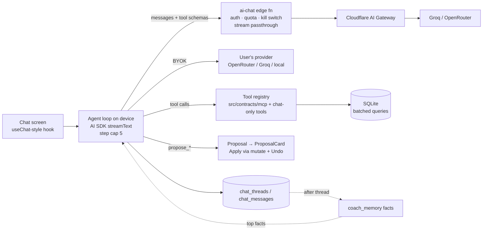

# Ask Incline: chat design

Status: proposed (2026-11-12). Extends [AI-ARCHITECTURE.md](AI-ARCHITECTURE.md) and [AI-PLATFORM.md](AI-PLATFORM.md); nothing here replaces their rules.

## Decision in one paragraph

Ask becomes a real conversation. The agent loop runs **on the device**: tools read the local SQLite database directly (the source of truth), and the model is reached through a thin streaming proxy (`ai-chat` edge function) or the user's own key (BYOK). Answers are streamed text plus **typed parts**: tool activity, data cards, and the same proposal cards we already use (preview → Apply → Undo). Chats are saved locally per thread. Long-term memory is a small set of **structured facts** the user can see, edit and delete, not a transcript dump. Built on the Vercel AI SDK core (`ai`), with our own UI on the design system.

---

## 1. What chat is for, and what it isn't

AI-ARCHITECTURE §1.5 says "context-aware, not chatty". Chat keeps that rule:

- **In-place chips stay the primary surface.** Session, template editor, Home and post-workout chips are where most AI use happens. Chat doesn't replace any of them.
- **Chat is for questions that cross screens**: "why has my bench stalled?", "make next week lighter, my knee hurts", "compare this month to last", "what should I do today with 40 minutes?".
- **Every answer still ends in at most 3 actions** (§1.1). A chat reply is short text plus cards and buttons, not an essay.
- **Changes are never made by chat directly.** Chat produces the existing typed proposals (`TemplateDiff`, `PlanDiff`, and later `LogSet` and `NutritionEntry`). The user applies them, and they appear in the activity log with Undo.

Rule change: §1.5 becomes "Context-aware first; chat for questions that cross screens, still action-ended."

## 2. Experience

### 2.1 Entry points
| Where | Opens with |
|---|---|
| iOS Ask tab / Android AI button | The current hero, a composer, and starters scoped to the screen you came from (`useAiEntry.from`). Recent threads are listed below. |
| Long-press a chip / "Ask about this" on a card | A new thread with that object attached as context (an exercise, workout, routine, plan, or week report). |
| During a workout | A **sheet over the session**, never a route change. Read-only by default. It is pinned to the active session, and the timer and logging keep running (§1.6, the gym loop never waits). |

### 2.2 Screen anatomy (top to bottom)
- **Header**: the brand hero collapses to a compact title bar once a thread has messages. A thread menu offers rename, delete, and "Don't remember this chat".
- **Message list**: FlashList, inverted, with rows kept presentational (AGENTS.md list rules).
- **User message**: a right-aligned bubble. An attached context object shows as a chip above it.
- **Assistant message**: no bubble (the style of current assistant apps). It is a stack of **parts**:
  - `text`: short markdown, streamed.
  - `tool activity`: one quiet line per step, for example "Looked at 6 bench sessions". It collapses, and you tap it to see what was read. Identical consecutive calls merge into one line with a count. Raw JSON is never shown.
  - `data card`: a reused component (records, the e1RM trend sparkline, sets per muscle, a workout summary row). Numbers in cards come from tool output, not from model text.
  - `proposal card`: the existing `ProposalCard` with a diff preview, Apply and Undo.
  - `source chip`: "Based on your last 6 bench sessions" (§1.4). Tap it to open the data.
  - `actions`: at most 3 buttons (Apply, Start workout, Open routine, Log).
- **Follow-up suggestions**: 2–3 chips under the last reply, generated with the reply rather than in a second call.
- **Composer**: a multiline input, a send button that becomes **Stop** while streaming (Stop really cancels the request through `AbortSignal`), and an attach button that adds context (an exercise, workout or routine picker). A voice button comes later (Phase 5).

### 2.3 States the UI must cover
- **Streaming**: the text shows a caret; tool activity appears as it happens; a proposal card is shown as a skeleton until its diff validates.
- **Offline**: the composer stays usable, sending is queued with an "Offline — will send when you're back" notice. The rule-based fallback answer is shown where one exists.
- **Rate-limited, kill switch, or provider down**: reuse the AI-ARCHITECTURE §3 table and `ai-fallback-notice`.
- **Ungrounded output**: if a number fails the number gate, that sentence is dropped and replaced with "I don't have enough data for that yet". The other parts of the reply still show.
- **Empty history**: starters only, plus one line about what Incline can see ("Your logged workouts, routines and records. Nothing changes until you approve it.").

### 2.4 Motion and feel
- Text streams as words fade in, with no typewriter jitter. A tool line fades in when it starts and ticks when it finishes.
- A proposal card rises in using the existing `rise()` motion. No springs on content (see #351).
- Haptics: a light tick when a proposal arrives, success on Apply. Nothing on each streamed token.
- **Reference check before PR**: compare side by side with ChatGPT, Claude and Gemini mobile for the composer, stop, streaming and thread list, the same way gym-loop surfaces are checked against Hevy and Strong.

## 3. Architecture



### 3.1 Why the loop runs on the device
- **SQLite is the source of truth.** On the device, tools read it with no sync lag, no upload of history, and nothing to keep consistent between server and device.
- **BYOK and the coming on-device models (`expo-ai`, SDK 59)** use the same loop. Only the provider changes.
- **The server stays thin**: auth, quota, kill switch and streaming. That fits the 150 s wall-clock limit on Edge Functions because the server never runs the loop itself.
- **Privacy**: only the rows a tool returns for this question leave the device, not the whole history.

The cost is that the tool round-trips happen on the phone's network. With a step cap of 5 and a light model, that is acceptable. If it becomes a problem on device, the server-loop variant can reuse the same tool definitions, because `incline-mcp` already runs them server-side.

### 3.2 Library choice
| Need | Choice | Why |
|---|---|---|
| Streaming, tool calls, multi-step loop, message parts | **Vercel AI SDK core (`ai`) + `@ai-sdk/openai-compatible`** | Has an official Expo guide (streams with `expo/fetch` plus a few polyfills). Typed tool parts (`tool-{name}`). `stopWhen` gives a step cap without writing our own loop. It works with any OpenAI-compatible endpoint, which our proxy, BYOK and Ollama all are. Replaces the hand-rolled loop the architecture doc planned. |
| Chat UI | **Our own components** on SYSTEM.md tokens | The React Native primitives in `assistant-ui` are unstyled. Our cards (`ProposalCard`, `SourceChip`, `StatBlock`) already exist, and the design system lint applies to us anyway. Revisit `@assistant-ui/react-native` if branching or editing messages becomes a need. |
| Schemas | `zod` (already the norm for AI SDK tools) | We already have contract types in `src/contracts`, so we derive zod from them or define them next to them, with one source per tool. |
| Agent framework (LangGraph, Mastra) | **No** | §5's rule still holds: under 10 tools and one loop. |

**Version check before coding**: confirm the current major versions of `ai` and `@ai-sdk/react` (sources disagree, v5 docs vs `ai@7`) and that they run on Hermes with the polyfills. **Spike first**: one tool, streamed, on incline_pixel, before anything else.

### 3.3 The `ai-chat` edge function
- It accepts OpenAI-style `messages` + `tools` and streams the upstream SSE back unchanged. It does not run tools.
- It reuses `ai-task`'s auth (Clerk JWT), the per-user quota table, `ai_flags` (the kill switch) and `upstreams()` (primary → fallback through the Cloudflare AI Gateway).
- Quota is per **turn**, not per step. A turn is one user message plus up to 5 model steps. Proposed free tier: 30 turns a day, adjustable with no release.
- The system prompt is built **on the device** and capped in size. The server adds a short safety preamble that the client can't remove.
- Model: the default must be good at tool calling. Run the chat eval set (§7) across Groq's tool-capable models and an OpenRouter fallback before choosing. `gpt-oss-20b`'s JSON-task scores don't carry over to tool calling.

### 3.4 Tools
Every tool is read-only, batched (`WHERE id IN (...)`, never a query per row) and **returns small, shaped results** (top N, summaries), never raw tables.

| Tool | Source | Notes |
|---|---|---|
| `get_profile`, `list_routines`, `get_routine`, `list_workouts`, `get_workout`, `get_exercise_history`, `get_personal_records`, `get_training_summary`, `search_exercises` | Existing MCP contracts (`src/contracts/mcp/tools.ts`) | Same names and schemas. The device implementation runs on SQLite; the MCP one runs on Supabase. |
| `get_active_session` | new | Only during a workout. |
| `get_plan`, `get_plan_progress` | new | For the plan questions. |
| `get_body_metrics` | new | Weight and measurements, only if the user has logged any. |
| `get_memory` | new | Reads facts. Usually injected into the prompt anyway; the tool is for "what do you know about me?". |
| `propose_template_edit`, `propose_plan_edit`, `propose_routine` | wrap existing tasks | They return a **Proposal**, never a write. The UI shows `ProposalCard`. |
| `remember` | new | Proposes a memory fact. It shows as a "Saved to memory · Undo" chip. |

Rules:
- **Tool results are data, not instructions.** Exercise names, notes and routine names are wrapped in a delimiter and labelled as user data. This closes #153 for chat.
- **Numbers**: every number in the reply text must appear in that turn's tool output or the user's message. This generalises `collectAllowedNumbers` to a per-turn allowed set.
- **Step cap of 5**: when it's hit, the reply says what it found so far and offers "Keep going".

### 3.5 Context assembly (per turn)
1. System prompt: role, tone (§1.7), the action rules, the tool rules, units, today's date, and the active gym if one is set.
2. Memory: the top facts by relevance and recency, about 15 at most, each with its id so the model can cite it.
3. Screen context: the attached object or the screen you came from, as a short JSON summary.
4. Thread history: the last N turns in full plus a **running summary** of older turns. The summary is made by a cheap call when the thread passes about 20 turns.
5. Tool schemas: only the tools that fit the context. During a session there are no plan-edit tools.

## 4. Storage: threads and history

New SQLite migration `023_chat.ts`:

```text
chat_threads   (uuid, title, context_kind, context_id, memory_off, created_at, updated_at, deleted_at)
chat_messages  (uuid, thread_uuid, role, parts_json, created_at)  -- parts = AI SDK UIMessage parts
```

- Reads go through TanStack Query; writes go through `mutate()` (AGENTS.md data rules).
- The title is generated after the first reply as part of the same response, with no extra call.
- **Sync is opt-in** (Settings → AI → "Sync chats across devices"), off by default. When on, threads sync through the outbox like other tables; Supabase gets `chat_threads` / `chat_messages` with RLS restricting each user to their own rows.
- **Retention**: keep everything locally until deleted. "Delete all chats" lives in AI settings. Sign-out wipes chats along with everything else (#346).
- **Temporary chat**: a toggle in the composer. The thread isn't saved and isn't used for memory, the same as ChatGPT and Claude.

## 5. Memory

The pattern most memory systems have settled on: **structured facts the user owns**, with a reasoning step deciding which facts to keep or update, not "embed every message and fetch the top K".

- **Store**: the `coach_memory` table already planned in AI-ARCHITECTURE §1b. Columns: `(uuid, kind, text, source, source_ref, confidence, created_at, last_used_at, expires_at)`. Example kinds:
  - `preference`: "avoids barbell squat"
  - `constraint`: "left knee: no deep flexion"
  - `goal`: "bench 100 kg by March"
  - `equipment`: "home gym has no cable machine"
  - `schedule`: "trains Mon/Wed/Fri, 45 min"
- **Writes**, three ways, all visible:
  1. The user asks explicitly ("remember I…"). This calls the `remember` tool and shows the "Saved to memory · Undo" chip.
  2. **End-of-thread extraction**: once a thread has gone quiet for a while, a single cheap call proposes facts with **ADD / UPDATE / DELETE against the existing facts**, so contradictions get reconciled. New facts land as "suggested" and appear in the "What Incline knows" screen for one-tap confirmation. They don't change behaviour until confirmed (with an option to auto-confirm later).
  3. `ai_feedback` signals, as planned: rejecting the same exercise twice proposes an "avoids X" fact.
- **Reads**: facts are injected into the prompt (§3.5). A reply that used a fact can show a small "Using: knee constraint" source chip.
- **Decay**: `last_used_at` and `expires_at` let goals and injuries expire or ask "still true?" after 8 weeks.
- **Control**: the "What Incline knows about you" screen lists facts by kind, with edit, delete, "pause memory" and "clear all". Temporary chats and memory-off threads never write facts.
- **Not adopted**: Mem0, Letta and Zep. They are server-side memory services with their own storage, and our facts are tens of rows in SQLite. Revisit if facts grow past a few hundred per user or we need semantic recall over old chats. Then the next step is local embeddings plus `sqlite-vec`, not an external service.

## 6. Safety and privacy
- The guardrails in AI-ARCHITECTURE §1.3 / §3 apply unchanged: grounded-or-silent, the number gate, no medical claims, and alternatives offered for injury questions.
- A data line sits under the composer on first use: "Ask sends only the data each answer needs to the AI provider." It links to AI settings, which show the provider in use (Incline-hosted or BYOK).
- No secrets or tokens ever go into the prompt. Custom exercise names are sanitised (#153).
- Quotas and the kill switch apply to chat as a whole and per tool category (for example, the `propose_*` tools can be switched off remotely).
- Every applied proposal goes to `ai_activity` with `actor = 'chat'` and the `thread_uuid`, so it can be undone from the log as well as from the chat.

## 7. Evals and verification
- **New eval set `evals/chat`**: about 40 scripted conversations against fixture data. Each checks:
  - the right tools were called (and no others);
  - the step count stays within the cap;
  - every number in the reply is grounded;
  - the reply has at most 3 actions;
  - proposals validate;
  - injection fixtures (a routine named "ignore previous instructions…") change nothing.
- **Model choice** is made from this eval, not guessed, and re-run when the provider or model changes.
- **Failure drills on incline_pixel**, as in AI-ARCHITECTURE: airplane mode mid-stream, Stop mid-tool, a forced 429, the kill switch, and a slow provider (25 s).
- **Performance**: there is no per-row async work in the message list. Streaming updates only the last row. Time to first token is under 1.5 s on the Incline-hosted path.

## 8. Phases (each one a PR, or a few)

| Phase | Ships | Done when |
|---|---|---|
| **0. Spike** | AI SDK + polyfills on Hermes; one streamed reply with one tool (`get_personal_records`) through a dev `ai-chat` | Streams on incline_pixel; Stop cancels; versions pinned |
| **1. Chat core** | `ai-chat` edge fn (auth, quota, flags, passthrough); chat screen (text, tool activity, stop); the 9 MCP read tools on SQLite; local threads (`023_chat`); thread list on Ask | Can ask "how's my bench going?" and get a grounded answer with a source chip, saved as a thread |
| **2. Cards + actions** | Data cards; `propose_*` tools rendering `ProposalCard`; follow-up chips; attach context; Ask-about-this entry from cards | A plan edit made from chat applies and undoes; it shows in the activity log |
| **3. Memory** | `coach_memory`, `remember`, end-of-thread extraction, "What Incline knows" screen, temporary chat | The squat-avoidance verification from AI-ARCHITECTURE passes through chat |
| **4. In-session sheet** | The chat sheet over the active workout, session tools, read-only defaults | The timer and logging never stall while chat streams |
| **5. Later** | Voice input; opt-in chat sync; on-device provider (`expo-ai`, SDK 59); MCP Apps UI for proposals in Claude and ChatGPT (`incline-mcp` already has the tools) | — |

`evals/chat` grows with every phase. The side-by-side check against reference apps happens at Phases 1 and 2.

## 9. Open questions for the product owner
1. Free daily turn limit (30 proposed) and whether BYOK is unlimited.
2. Whether chat sync should be off by default (proposed), or on to match other synced data.
3. Whether memory facts from extraction need confirmation before use (proposed: yes at first).
4. Whether the in-session sheet is allowed to propose changes to the current workout (proposed: read-only in Phase 4; changes later).

## Sources (checked 2026-11-12)
- [AI SDK: Expo quickstart](https://ai-sdk.dev/docs/getting-started/expo) — `expo/fetch` streaming, polyfills, `stopWhen` step cap, `tool-{name}` parts.
- [AI SDK: chatbot with tool calling](https://sdk.vercel.ai/docs/ai-sdk-ui/chatbot-with-tool-calling)
- [assistant-ui for React Native](https://www.assistant-ui.com/docs/react-native) — unstyled primitives, Expo support; [AI SDK v7 runtime notes](https://www.assistant-ui.com/docs/runtimes/ai-sdk/v7).
- [MCP Apps overview](https://modelcontextprotocol.io/extensions/apps/overview.md) and [SEP-1865](https://modelcontextprotocol.io/seps/1865-mcp-apps-interactive-user-interfaces-for-mcp) — `ui://` resources with a text fallback.
- [Agentic UX patterns 2026](https://zylos.ai/research/2026-05-28-agentic-ux-frontend-design-patterns-ai-agents/), [AI agent UI patterns: plans, approvals, undo](https://www.setproduct.com/blog/ai-agent-ui-design-patterns), [Generative UI in 2026](https://daily.dev/posts/generative-ui-in-2026-a-developer-guide-that-ships-didpe5oji)
- [Mem0 vs Letta](https://vectorize.io/articles/mem0-vs-letta), [Agent memory 2026: episodic, semantic, procedural](https://dev.to/dublecc/how-ai-agent-memory-works-in-2026-context-episodic-semantic-and-procedural-l3f), [Mem0 paper](https://arxiv.org/html/2504.19413v1)
- [Supabase Edge Functions for AI workloads](https://automationatlas.io/answers/how-to-set-up-supabase-edge-functions-for-ai/) — the 150 s wall-clock limit.
