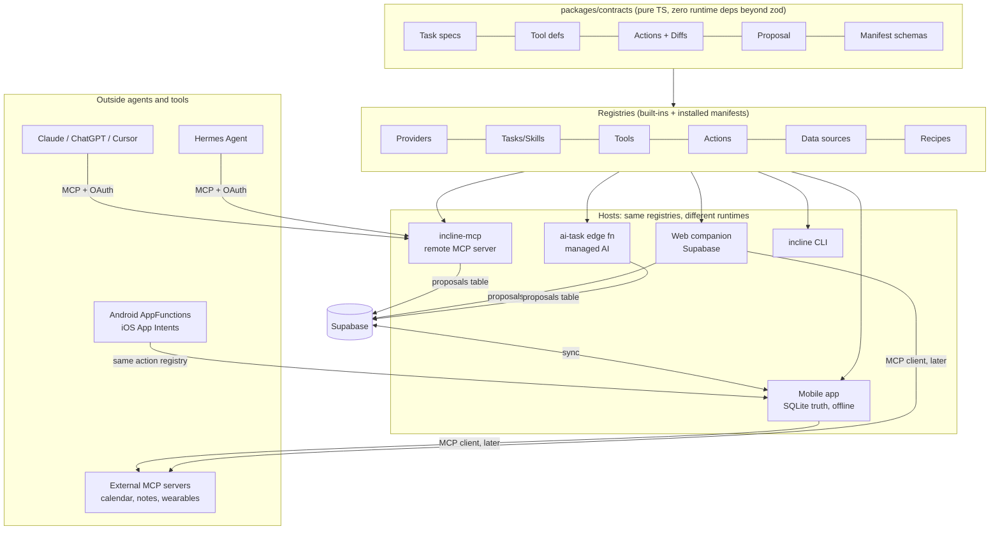

# AI platform: extensibility, interop and cross-device (proposed)

**Status:** Accepted 2026-11-04. The decisions are in §10. Each one says what we do now and what would make us switch. The review gate (§11) runs next, before the rest of step 1.

**How to use this doc.**
- §0 is the rule everything follows. §1 is the target shape.
- §2–§9 cover one topic each. Expand a topic in place when its step starts.
- §10 holds the decisions. §10b says which off-the-shelf tool to adopt at which step. §10c covers tracking.
- Changing a decision means editing its row and adding a dated line to the change log at the end.

**Extends:** [AI-ARCHITECTURE.md](AI-ARCHITECTURE.md). That doc covers one app talking to models. This one covers Incline as a *platform*:
- other agents can use it;
- users can extend it;
- it runs across devices;
- it survives the next protocol or model shift.

---

## 0. The one rule that shapes everything

> **Extensions are data. Capabilities are code. Writes are proposals.**

- **Extensions are data.** Everything a user, a marketplace or an external agent adds is a *declarative manifest*: prompts, skills, provider profiles, content packs, automation recipes and connector configs. None of it is code we download and run.
  - App stores forbid downloading executable code that changes app behaviour (Apple 2.5.2, the Play policy on dynamic code).
  - Third-party code in the gym loop is a reliability and security hole.
- **Capabilities are code.** Tools, validators, actions and diff appliers are first-party, versioned TypeScript, shipped in releases or OTA. An extension can only *compose* capabilities that already exist.
- **Writes are proposals.** Whatever originates a change (in-app AI, MCP client, web, automation, Hermes, a future agent), the change becomes a `Proposal`. A human applies it, or a scoped grant auto-applies it. It always goes through `mutate()` and is logged in `ai_activity`.

This is what lets a marketplace, MCP and unknown future agents plug in without each one being a new security review.

---

## 1. Target shape



**Hosts never fork the logic.** The tool `get_history`, the action `apply_template_diff` and the task `template.modify@v3` are one definition each. They are exposed in-app, over MCP, on the web and in the CLI. This is the "deep cross-integration" property. It costs one package boundary, not N integrations.

---

## 2. Extensibility and ecosystem

### Extension kinds (all declarative manifests)
| Kind | Example | Composes |
|---|---|---|
| **Skill** | "Knee-friendly modifier", "Powerlifting peaking coach" | instructions (agentskills.io `SKILL.md` shape) + allowed tools + output action type |
| **Prompt pack** | tone variants, other languages, coach personas | prompt templates for existing tasks (versioned, eval-gated) |
| **AI profile** | "My OpenRouter key, Sonnet for plans, Groq for chips" | BYOK/managed provider config + per-task routing; never a secret in the manifest |
| **Content pack** | Winter Arc 12-wk, 5/3/1, home-gym templates | templates, programs, challenge presets |
| **Recipe** | "After leg day, if sleep < 6h, suggest a deload" | trigger + rule condition + action (§6) |
| **Connector** | Garmin, Notion, Google Calendar (via MCP) | data source or tool endpoint + scopes |

### Manifest (sketch)
```ts
{
  id: 'com.incline.skill.knee-friendly', version: '1.2.0', kind: 'skill',
  publisher: { id, verified: boolean },
  contract: '^1.0',                       // contracts package semver range
  permissions: ['read:history', 'read:catalog', 'propose:templates'],
  provides: { skill: { instructions: 'SKILL.md', tools: ['search_exercises','get_history'], emits: 'TemplateDiff' } },
  evals?: 'evals/*.json',                 // required for marketplace listing
  integrity: 'sha256-…', signature?: '…'
}
```

### Marketplace: staged, not big-bang
1. **Built-in packs as manifests.** Ship our own presets in manifest format. There is no marketplace yet, but the format gets proven. *Cheap, do with step 2/3.*
2. **Import by link or file.** Power users share packs as JSON or a URL. Install = an `extensions` row (synced), with a permission prompt at install.
3. **Curated catalog.** A Supabase table plus a review queue. Listing needs evals that pass and signed integrity.
4. **Open marketplace, revenue share.** Only with real demand, and after the governance in §7 exists.

**Evaluation:** strong fit, low cost *if* the contracts package and the manifest schema land before we write many more tasks. If they land late, every task written meanwhile has to be retrofitted.

---

## 3. AI and agent infrastructure

| Piece | Today | Target |
|---|---|---|
| Provider seam | `AiProvider` + router, BYOK/gateway/none | Same seam. Add an **AI profile** (named, per-task routing, synced without secrets) and `expo-ai` (step 7) |
| Tasks | Code objects (`narrate.ts`) | **Task spec** (id, version, input/output schema, prompt ref, tools, emits) + code validator. Skills reuse the spec with instructions swapped in |
| Tools | Planned read-only registry | One registry. Each tool declares `scope`, `cost`, `sideEffects: none`. The same defs are exported to MCP and to AppFunctions |
| Actions | `applyAiChange` + revert handlers | **Action registry**: `{type, schema, preview(), apply(), revert()}`. Proposal = list of actions. Every host uses the same appliers |
| Agent loop | Planned ~80-line step-capped loop | Keep it. Add `actor` + `grant` to the run context so the loop knows what it may propose and what it may auto-apply |
| Memory | Planned `coach_memory` | Same; exposed as a read tool + the "What Incline knows" screen; never writable by external agents except via proposals |

**Hermes and other agent runtimes.** Hermes Agent (Nous Research, MIT, runs on the user's own machine or server) speaks MCP and agentskills.io `SKILL.md`. We don't integrate *with Hermes* specifically. We expose `incline-mcp` and publish our skills in the `SKILL.md` format:
- Hermes, Claude, Codex, Cursor or whatever comes next can drive Incline;
- an Incline skill pack works both in-app and in those agents.

That is the future-proof move: target the **standards** (MCP, `SKILL.md`, OpenAI-compatible chat, JSON Schema), not the products.

**Not yet:** an agent framework, multi-agent orchestration, A2A. Revisit when an external agent needs to *delegate* to Incline as a peer agent rather than call tools. MCP covers tool calls.

---

## 4. Integrations and interoperability

**Outward (others use Incline):**
1. **`incline-mcp` (#242).** A remote MCP server (Streamable HTTP; Supabase edge or Cloudflare Worker) using the current spec (2026-07-28: stateless core, Tasks and Apps extensions).
   - **Tools:** read tools plus `propose_*` tools that create proposals.
   - **MCP Apps:** the proposal preview is rendered as an MCP App (`ui://` resource), so Claude or ChatGPT shows the same diff card the phone does.
   - **MCP Tasks:** long jobs such as "draft a 12-week plan" run as MCP Tasks.
   - **Auth:** OAuth 2.1 with Clerk as the authorization server (we already use Clerk; it documents MCP auth; verify the current Clerk feature set when building).
2. **Export JSON** (the existing stable contract), plus **webhooks** later (`workout.completed`, `proposal.applied`).
3. **OS agents:** Android **AppFunctions** and iOS **App Intents** let Gemini or Siri call "log set", "start template" and "what's my bench PR" on-device. They map 1:1 from the action and tool registries, which keeps the next platform shift cheap. *Needs a native build; after Health Connect.*

**Inward (Incline uses others):**
- **DataSource adapters:** Health Connect, CSV, Hevy, Garmin. Rows carry `source` + `external_id`.
- **MCP client (later):** connect the user's own MCP servers (calendar, to schedule workouts; notes). Their tool output is *untrusted content* (§7). Start on web and server, where MCP clients are mature. Mobile follows.

**Interop contracts to keep stable:** catalog IDs, export JSON, the contracts package (semver), manifest schema (semver), and the MCP tool names (versioned by suffix only on breaking change).

---

## 5. Cross-device architecture

| Concern | Decision |
|---|---|
| Source of truth | Device SQLite for the user's data (unchanged). Supabase is the sync hub and the truth for server-born objects |
| Server-born proposals (web, MCP, automations) | New synced `proposals` table. The app shows a **proposal inbox** (badge on Home). Applying on any device writes through that device's `mutate()`; the status syncs |
| Activity log | `ai_activity` gains `actor` (`app_ai`, `web`, `mcp:<client>`, `recipe:<id>`, `user`) and `device_id`; syncs, so "Revert" works from any device when the revert handler can run there |
| AI settings | **AI profile** (provider, model, routing) syncs. **Secrets never sync** by default; they stay in each device's keystore |
| BYOK on web / MCP | Optional "Use my key everywhere": the key is encrypted in Supabase Vault and used only by our edge proxy. Off by default; we take custody only when the user opts in (D3) |
| Extensions | Installed set syncs (`extensions` table); manifests are cached per device; each device resolves `contract` compatibility for its own app version (an older binary hides incompatible packs) |
| Kill switches | Remote flags per task, per extension and per actor, cached in kv. One app open applies them everywhere |

**Device classes:**
- **Phone:** full; on-device AI where supported.
- **Web:** full, with server AI only.
- **Watch, widgets, OS agents:** actions only, no chat.
- **Headless (MCP, CLI, Hermes):** tools + proposals.

---

## 6. Automation and orchestration

**Yes, but small:** a **recipe engine**, not a workflow platform.

```
trigger  : workout.completed | week.ended | health.synced | schedule(cron) | challenge.checkin
condition: rules over feature packs (no LLM in the condition)
action   : suggest(proposal) | notify | run_task(→ proposal) | export
```
- **Device engine** for local events: runs inside `mutate()` post-commit hooks. It is cheap and offline.
- **Server engine** for schedules and cross-device events: Supabase `pg_cron` + edge functions.
- **Guardrail:** recipes only ever produce *suggestions or notifications*. Auto-apply needs an explicit per-recipe grant, limited to low-risk action types such as tagging and export.
- Built-in recipes come first (Winter Arc check-ins, deload nudge). User-authored recipes come after the governance work.

**Not yet:** a visual workflow builder, n8n/Temporal/Workflows-style orchestration. Revisit when recipes need multi-step branching with waits.

---

## 7. Security, governance and control

Required **before** third-party packs or MCP write access. Mostly cheap if designed in now:

1. **Scopes everywhere.** `read:history`, `read:health`, `read:nutrition`, `propose:templates`, `apply:low_risk`, etc. Manifests request scopes, OAuth tokens carry them, tools check them.
2. **Lethal-trifecta rule.** A single agent run never combines (a) private data, (b) untrusted content (an external MCP server, a web page, a third-party skill) and (c) an exfiltration path (outbound HTTP, message sending). The tool registry tags each tool with these, and the loop refuses any combination that would complete all three.
3. **Proposal-only writes.** External actors can't call `mutate()`; grants can auto-apply only allow-listed low-risk action types.
4. **Audit:** `ai_activity` with actor, scopes used, extension id + version. Export and delete are covered by account deletion (already handled).
5. **Supply chain:** packs carry integrity hashes, verified publishers sign them, listing requires evals, and a kill switch per extension.
6. **Spend:** per-user/day quotas on managed AI (exists for narrate; generalise in `ai-task`), budget caps on synced BYOK.
7. **Health data:** stays in the health permission scope. It is never sent to external MCP clients unless the token holds `read:health`, and AI only sees daily aggregates (unchanged).

**Later:** org/team governance (coach accounts managing clients) needs a tenancy model. That is out of scope until a coaching product exists.

---

## 8. Developer and power-user ecosystem

| Audience | Gets |
|---|---|
| Power users | BYOK + local models (done), AI profiles, custom prompts/skills in-app (edit a copy of a built-in), pack import, recipes, MCP access from their own Claude/Hermes, export JSON |
| Pack authors | Published JSON Schemas for manifests, `incline pack validate` and `incline pack eval` (reusing `evals/`), a stub provider for offline testing, docs |
| Integrators | MCP server, export JSON, webhooks, a later REST API (generated from the same tool defs) |
| Us (and Claude) | `incline-ai-task` and `incline-ai-surface` skills; a scaffold that generates task spec + validator + evals + manifest in one go |

The CLI and MCP server share code: the CLI is just an MCP client with a TTY (as chrisdoc/hevy-mcp did; see ECOSYSTEM.md).

---

## 9. Future-proofing

| Shift | How we're covered |
|---|---|
| New models / vendors | Capability flags + OpenAI-compatible wire format + per-task routing + evals gate swaps |
| On-device models (expo-ai, Gemini Nano, Apple FM) | `onDevice` provider capability; tasks sized by `tier` |
| New agent runtimes (Hermes, whatever's next) | MCP + `SKILL.md` + OAuth; we target standards, not products |
| OS-level agents (Gemini, Siri) | Action registry → AppFunctions / App Intents |
| Voice / realtime / multimodal | Inputs are just another task input type; actions are unchanged |
| Protocol churn (MCP revisions) | MCP lives in one adapter host (`incline-mcp`); registries don't import MCP types |
| Our own refactors | Contracts package with semver; manifests pin a contract range; DB migrations as today |

**Standing triggers** (to add to AI-ARCHITECTURE's "Not yet" table): A2A when peer-agent delegation is needed; a workflow engine when recipes need waits and branches; vector search when SQL+rerank fails; org governance when a coaching product exists.

---

## 10. Decisions (accepted 2026-11-04)

Each decision got one of two answers:
- **Adopt now:** cheap today, and costly to retrofit later.
- **Defer:** the current way is fine for this scope, and switching later is easy.

| # | Decision | Now | Why | Switch when |
|---|---|---|---|---|
| D1 | Where contracts live | **Adopt, scaled down.** `src/contracts/` is a pure-TS folder: no React Native, Expo or DB imports, enforced by lint. `scripts/sync-contracts.mjs` copies it into `supabase/functions/_shared/contracts/`, and CI fails on drift (closes #189) | Gets the boundary now, so new tasks are written against it. A workspace package adds Metro, Deno and import-map setup for only one extra consumer | A second JS host needs it (the MCP server or `web/`). Then `src/contracts/` moves to `packages/contracts` unchanged |
| D2 | Extension model | **Adopt.** Declarative manifests only; capabilities are first-party code | It's a principle, so it costs nothing. Store policy and security rule out the alternative | Never, for mobile |
| D3 | BYOK across devices | **Adopt (as built).** Keys stay in each device's keystore | Zero work; we hold no user secrets | Web or MCP users ask to use their own key there. Then an opt-in Supabase Vault and proxy |
| D4 | External-agent writes | **Adopt (as built).** Proposals only | Zero work; it matches `applyAiChange` | A low-risk action type such as tags or export needs auto-apply. Then add scoped grants |
| D5 | MCP server host | **Defer.** Supabase edge function is the default | The tool definitions live in contracts, so the host is a thin adapter either way | When building MCP v1, check whether Cloudflare's `McpAgent` + OAuth library saves real work. If it does, use a Worker for that one host only |
| D6 | Order | **Adopt, trimmed.** Before templates AI: the contracts boundary, an action registry, and `actor` + `device_id` on `ai_activity`. MCP comes after templates; the marketplace after challenges | The schema change is cheapest before more AI writes exist, and templates AI is the first heavy user of actions | — |
| D7 | Skill format | **Defer the work, fix the choice.** When the first skill pack is written, it uses `SKILL.md`. Nothing is built now | There are no skill packs yet | A skill pack enters a step's scope (earliest: challenges content packs) |

### Impact on the current plan
The rest of step 1 grows by about 2–3 days. Templates AI and MCP get cheaper.

1. **Contracts boundary.**
   - Move into `src/contracts/`:
     - task spec types;
     - narrate schema and validators, which today are duplicated in `supabase/functions/coach-narrate/schema.ts`;
     - the action and proposal types.
   - Add the lint rule, the sync script and the CI drift check.
2. **Action registry.** Generalise `registerRevertHandler` into `{type, schema, apply, revert}`. `applyAiChange` takes an action, not a closure.
3. **Migration 021:** `ai_activity.actor` and `device_id`.
4. **`ai-task` edge function.**
   - It resolves task specs from the synced contracts.
   - It sits behind Cloudflare AI Gateway.
   - `coach-narrate` becomes one task within it.
5. **Kill switches** keyed by task and actor. Keying by extension comes when extensions exist.

Then steps 2–7 as planned, with these inserted:
- **MCP v1** after templates: read tools, `propose_template_diff`, and an MCP App preview. Promote contracts to a package here (D1).
- **Built-in content packs** with challenges. Winter Arc ships as a manifest; import by link comes later.
- **Recipes** with smart surfaces.
- **AppFunctions / App Intents** in the Health Connect native build.
---

## 10b. Buy vs build: adopt per step

Already in the stack: Supabase, Clerk, Sentry and EAS. Cloudflare AI Gateway comes in with the rest of step 1.

**Adopt each tool when the step that needs it starts, never ahead of it.** Every tool sits behind one of our seams, so adding it later is not a rewrite. At the start of each step, read its rows here first. Prices and limits are as of Nov 2026; check them again at adoption.

| When | Adopt |
|---|---|
| Rest of step 1 | Cloudflare AI Gateway |
| Kill switches | Our kv-cached flags. PostHog only if staged rollouts are needed |
| Templates AI, once prompts are tuned often | Langfuse |
| MCP v1 | MCP host + Clerk OAuth (D5) |
| Recipes | Supabase cron first; Trigger.dev or Inngest when jobs need retries and waits |
| External integrations | Composio, Arcade or Nango |
| Sync becomes a time sink | PowerSync evaluation |

| Topic | Need | Pick | Alternatives | Build ourselves |
|---|---|---|---|---|
| AI infra | Gateway: routing, retries, caching, spend caps, per-user keys | **Cloudflare AI Gateway** (free control plane) | LiteLLM proxy (OSS, virtual keys + budgets), Portkey (gateway + guardrails), OpenRouter BYOK | On-device router + fallback copy only |
| AI infra | Prompt versions, traces, evals, datasets | **Langfuse** (OSS; self-host or cloud). Send metadata only, or full content opt-in, to keep the privacy rule | Braintrust, Helicone, promptfoo (CI evals) | Eval fixtures stay in `evals/` |
| AI infra | Agent/tool loop | **Vercel AI SDK** (provider-agnostic, tool calling, MCP client) when our 80-line loop stops being enough | Claude Agent SDK, Mastra, OpenAI Agents SDK | Today's loop |
| Interop | Host the MCP server | **Cloudflare Agents SDK** (`McpAgent` + OAuth provider) or the Vercel MCP adapter on `web/` | Supabase edge function (D5) | Tool defs from contracts |
| Interop / security | OAuth for MCP clients | **Clerk** (already our IdP; has MCP auth support) | WorkOS AuthKit, Stytch Connected Apps, Descope | — |
| Integrations | Third-party app connections (Calendar, Notion, Strava…) with managed OAuth | **Composio** or **Arcade** (agent tool auth), **Nango** (raw OAuth + sync) | Pipedream Connect | Health Connect, CSV, Hevy (domain-specific) |
| Extensibility | Distribute MCP server / skills publicly | **Official MCP registry** + Smithery listing; skills via agentskills-compatible hubs | — | In-app pack catalog (no off-the-shelf mobile option) |
| Cross-device | SQLite ↔ Postgres sync | **Keep our outbox**; evaluate **PowerSync** (Supabase + Expo SQLite, managed) if sync bugs or conflict handling start costing time | ElectricSQL, Zero, Triplit | Outbox + `mutate()` today |
| Governance | Feature flags, kill switches, staged rollouts | **PostHog** (flags + product analytics + LLM analytics in one, generous free tier) | Statsig, GrowthBook (OSS), LaunchDarkly | kv-cached flag reader |
| Governance | Fine-grained permissions/scopes | Supabase RLS + token scopes until sharing/coaching exists; then **OpenFGA** or **Permit.io** | Oso | Scope checks in tool registry |
| Security | Secrets (server, CI, synced BYOK) | **Supabase Vault** for user keys; **Infisical** or Doppler for project secrets | 1Password Secrets Automation | — |
| Security | Prompt-injection / content guardrails | Gateway-level guardrails (Portkey or Cloudflare); **Llama Guard** class model if needed | Lakera | Trifecta rule + validators (ours, cheap) |
| Automation | Durable jobs, schedules, retries, AI steps | **Trigger.dev** or **Inngest** | Supabase cron + queues (enough at first), Temporal | Recipe rules (domain) |
| Dev ecosystem | Public docs site | **Mintlify** or Fumadocs (OSS) | Docusaurus | — |
| Dev ecosystem | SDKs from an API spec | **Stainless** or Speakeasy (when a REST API exists) | openapi-typescript | — |
| Observability | Errors, crashes, perf | **Sentry** (have) | — | — |

**Rule of thumb:** buy plumbing (gateways, auth, OAuth connectors, flags, jobs, sync, traces), build the domain (tools, actions, validators, proposals, pack format). Every bought piece sits behind one of our seams (provider, data source, flag reader, job runner), so it can be swapped later.

## 10c. Tracking architecture and how things connect

**Now:** everything stays on GitHub.
- Decisions live in `docs/decisions/`.
- Work goes on the "Incline" Projects board.
- Diagrams are Mermaid, kept in these docs.

**Revisit** when the board feels cramped or several projects are active at once. The table below is the upgrade path, following how strong teams do it, scaled to one person:

| Layer | Teams use | Pick for us |
|---|---|---|
| Decisions (why) | ADRs in each repo (MADR format), rendered as a site with Log4brains | Keep `docs/decisions/`; adopt MADR headings |
| Architecture map (what connects to what) | C4 model as code: Structurizr, **LikeC4**, or IcePanel (SaaS, collaborative) | **LikeC4**: OSS, models in the repo, interactive diagrams, and an MCP server so Claude can query the model. Use IcePanel if you prefer drag-and-drop |
| Catalog (every service, owner, API, dependency) | Backstage (self-host, heavy), Port, Cortex, OpsLevel | Not yet. Port's free tier when there are 5+ deployables across projects |
| Work (what's next, across projects) | Linear (initiatives → projects → issues), Jira | **Linear** (initiatives span projects; has GitHub sync and agent integrations), or the existing GitHub Projects board if staying all-GitHub |
| Knowledge (notes, research, specs) | Notion, Confluence | Notion, or keep it in repo `docs/` |

## 11. Review gate (runs next)

Run one review pass before more feature work. Each layer is checked:
- **Contracts:** every shared type lives in the package; there are no app-only imports.
- **Router/providers:** they don't depend on host specifics.
- **Writes:** they all go through action appliers + `applyAiChange` with an actor.
- **Edge:** it imports contracts rather than copying them.
- **UI kit:** it renders any action type's preview, not just templates.
- **Docs:** this file, AI-ARCHITECTURE and SYSTEM.md agree.
- **Tests:** contract tests run in both node and Deno.

Findings get fixed in one PR before templates AI starts.

---

## Change log

- 2026-11-04: `ai-task` deployed. It replaces `coach-narrate`, which was never deployed. One task table runs on the shared contracts, with:
  - an atomic per-user quota (`ai_task_consume`);
  - a per-user cache that never stores stubs;
  - a remote kill switch;
  - a Groq primary with an optional fallback upstream;
  - Cloudflare AI Gateway set through `AI_BASE_URL` / `CF_AIG_TOKEN`.

  It needs the user to set the secrets `CLERK_FRONTEND_API` and `GROQ_API_KEY`.
- 2026-11-04: Step-1 platform prep shipped:
  - the contracts boundary (#312);
  - the action registry (`src/ai/actions.ts`, `applyAiAction`);
  - migration 021 (`actor`, `device_id`);
  - kill switches (Supabase `ai_flags`, `src/ai/flags.ts`, refreshed once per app open).
- 2026-11-04: Accepted. D1 scaled down to an in-repo `src/contracts/` boundary plus a Deno sync; D5 and D7 deferred; tools adopted per step (§10b); tracking stays on GitHub (§10c).
